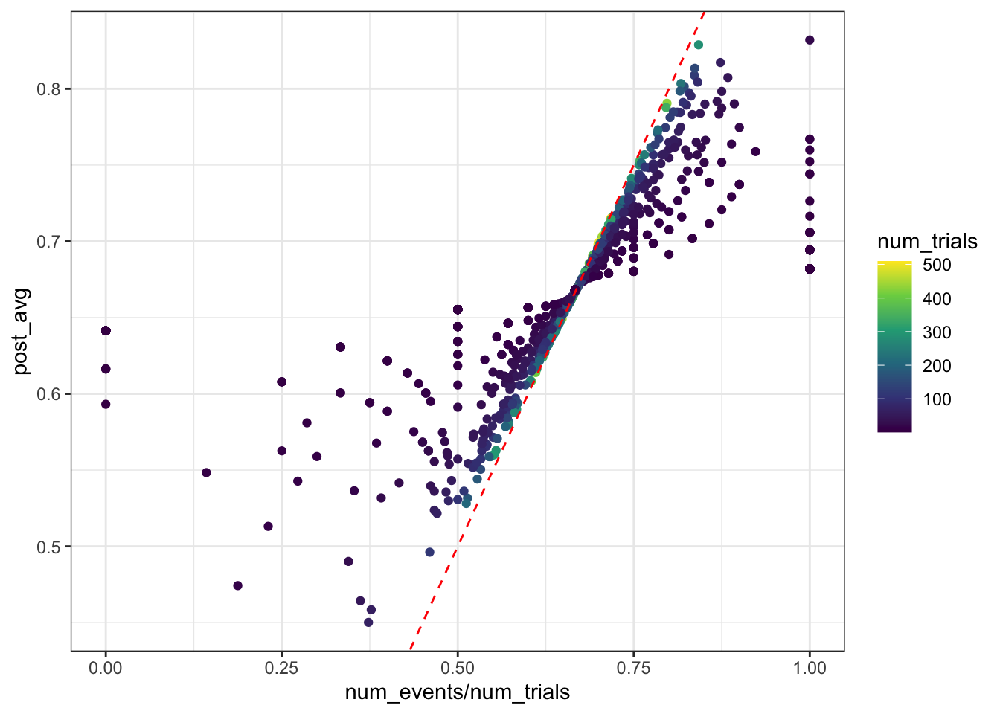
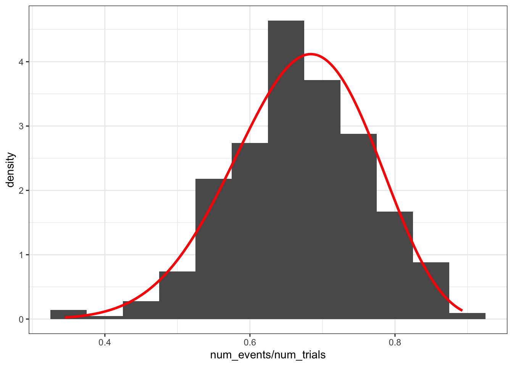
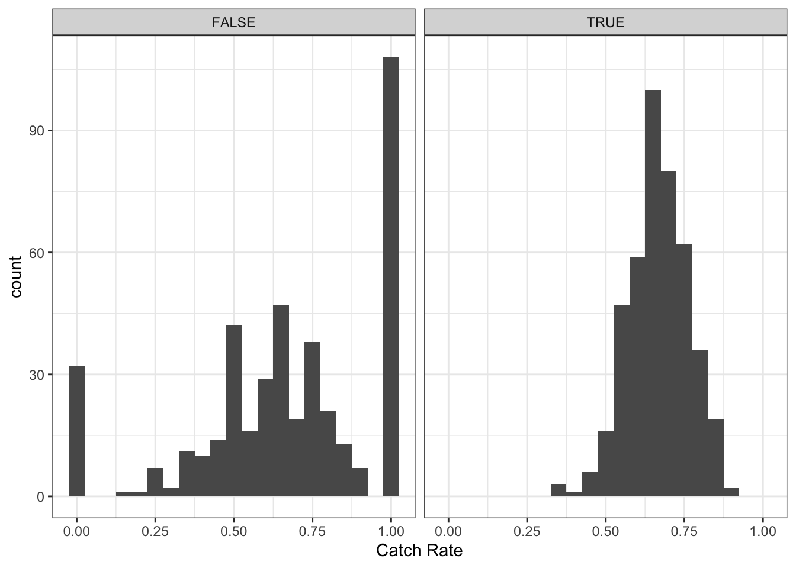
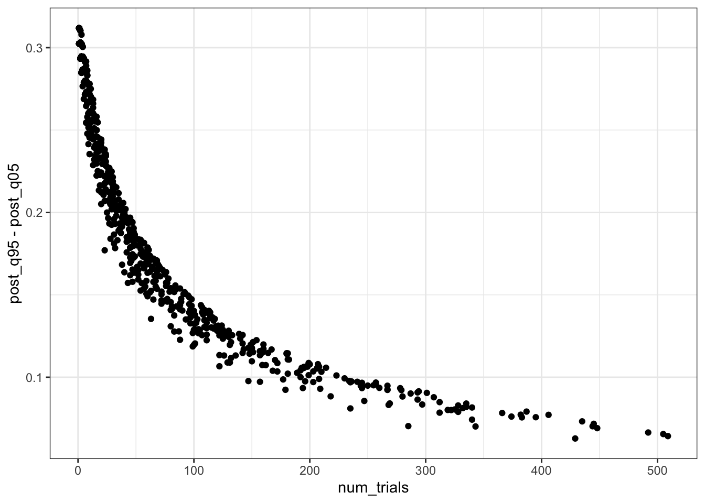
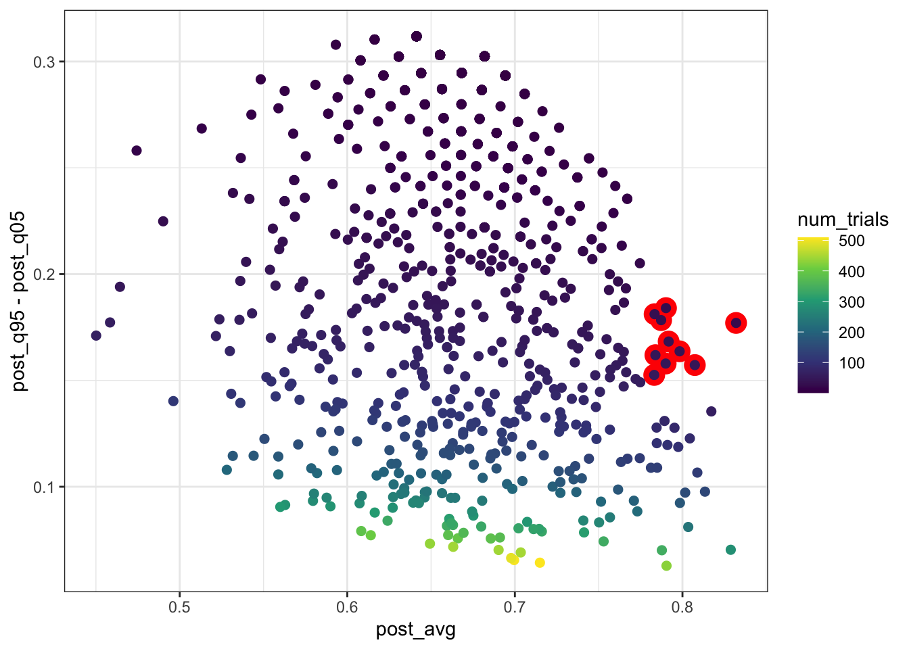

# Who really has the best hands in the NFL?

**Empirical Bayes estimates of NFL catch probability, with honest uncertainty**

A receiver who catches 3 of his 3 targets has a "perfect" 100% catch rate. Nobody actually believes he is perfect. Raw catch rates are very noisy for players who rarely see the ball, and that makes them a poor basis for evaluating talent or deciding who to sign.

This project replaces raw catch rates with **Empirical Bayes** estimates. A league-wide prior is learned from the data itself, and then each player's estimate is updated with his own catches and targets. Players with little data are pulled toward the league average, and players with lots of data keep estimates close to their own record. Every player also gets a full posterior distribution, not just a point estimate.



*Raw catch rate (x-axis) against the Empirical Bayes posterior mean (y-axis), coloured by number of targets. Low-volume players are pulled toward the league average; high-volume players stay near the dashed 45° line.*

---

## The question

For each player *j*, estimate the probability μ<sub>j</sub> of catching a pass, given *m<sub>j</sub>* catches (events) on *N<sub>j</sub>* targets (trials), and quantify how uncertain that estimate is.

## Data

- Real play-by-play data from the [`nflfastR`](https://www.nflfastr.com/) package: **849 players** with at least one target over the **2018, 2019 and 2020** seasons.
- Each row holds an anonymised `player_id`, `num_events` (receptions) and `num_trials` (targets).
- A second file holds a focus set of 23 players used for visual comparisons.

The data files are not included in this repository (see [`data/README.md`](data/README.md)).

## Approach

The model is a Binomial likelihood with a conjugate Beta prior:

```
m_j | μ_j  ~  Binomial(N_j, μ_j)
μ_j        ~  Beta(a, b)
μ_j | data ~  Beta(a + m_j,  b + N_j − m_j)
```

The analysis compares three ways of choosing the prior:

| Approach | Idea | What goes wrong |
|---|---|---|
| **No pooling** | Vague prior Beta(0.5, 0.5); each player judged on his own data | Small-sample players get extreme, unstable estimates (0% or 100%) |
| **Complete pooling** | One shared catch rate for the whole league | Every player gets the same estimate, so real skill differences disappear |
| **Empirical Bayes** | Learn *a* and *b* from the league, then update each player | A compromise that borrows strength across players |

For the Empirical Bayes prior, a Beta distribution was fitted by **maximum likelihood** to the observed catch rates of players with more than 24 targets. The log-likelihood was maximised over log(*a*) and log(*b*) with `optim()` (BFGS), and two different starting points converged to the same solution.



## Key results

- **Fitted league prior: Beta(15.8, 7.8).** That is worth roughly 16 catches on 24 targets, with a prior mean of about 67% and 90% of its mass between about **50% and 82%**.
- **The raw data is extreme at small samples.** About 100 low-volume players had a 100% catch rate and about 30 had 0%. The Empirical Bayes prior pulls them back to plausible values.

  

- **Shrinkage fades with volume.** As targets accumulate, the data overwhelms the prior and the posterior mean converges to the raw catch rate.
- **Uncertainty shrinks with sample size.** The width of the 90% posterior interval falls steadily as the number of targets grows.

  

- **From model to decision.** Plotting posterior mean against posterior uncertainty gives a scouting view. Players with a high mean *and* high uncertainty (circled in red) are upside bets: they could disappoint, but they could also be better than their record shows.

  

## Repository structure

```
.
├── analysis/
│   └── catch_rate_empirical_bayes.Rmd   # full analysis in R Markdown
├── report/
│   ├── catch_rate_empirical_bayes.pdf   # rendered report (viewable on GitHub)
│   └── catch_rate_empirical_bayes.html  # rendered report (download to view)
├── figures/                             # plots used in this README
└── data/
    └── README.md                        # where the data comes from and its format
```

## How to run

1. Place `midterm_all_data.csv` and `midterm_focus_data.csv` in `data/` (see [`data/README.md`](data/README.md)).
2. Install the R packages used: `tidyverse` (including `readr`, `dplyr` and `ggplot2`).
3. Open `analysis/catch_rate_empirical_bayes.Rmd` in RStudio and click **Knit**, or run:

   ```r
   rmarkdown::render("analysis/catch_rate_empirical_bayes.Rmd")
   ```

## Context

This analysis was completed as the midterm exam for INFSCI 2595 (Machine Learning) at the University of Pittsburgh. The report follows the exam's question-and-solution format. The Empirical Bayes approach used here is an approximation to a full hierarchical (partial-pooling) model, which would also estimate the prior's uncertainty instead of plugging in point estimates.

**Tools:** R, tidyverse, ggplot2

---

*Vedant Kansara* · [GitHub](https://github.com/vedantkan) · [LinkedIn](https://www.linkedin.com/in/vedantkan/)
